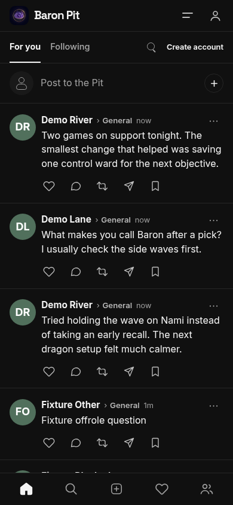
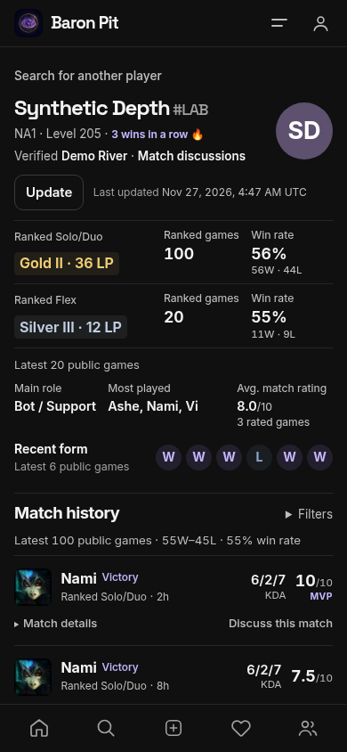

# Feed and player lookup

| Home feed | Player lookup |
| --- | --- |
|  |  |

These screens use isolated development accounts and synthetic matches. They show the dark appearance at 390 × 844 pixels.

The feed keeps the author, time, writing and conversation actions together. Search, rooms and duo discovery remain reachable through navigation. Public profiles open on contributions. Player lookup opens on rank, games played, win rate and recent form. Each game has a single **Discuss this match** action. Match details expand in place.

| Same phone, same fixture | Previous layout | This change |
| --- | ---: | ---: |
| Top of the first feed post | 238 px | 173 px |
| Top of the first match row | 1,554 px | 623 px |
| Height of that match row | 548 px | 101 px |

### Baron Match Rating v2

Each completed ranked Solo/Duo or Flex match on Summoner’s Rift supplies five direct comparisons. A support is compared with the opposing support in that same game. This controls the role, queue, game length and patch of each comparison. The sample consists of those two players. The rating describes their measured contributions within that match.

| Measure | Weight | Normalization floor |
| --- | ---: | ---: |
| Kill participation | 25 | 0.20 |
| Champion damage per gold earned | 20 | 0.4 |
| Vision score per minute | 20 | 0.3 |
| Deaths per 10 minutes, lower is better | 20 | 0.8 |
| Gold earned per minute | 10 | 180 |
| Objective damage per minute | 5 | 50 |

For each measure, divide the difference from the opposing role by the largest of the two values and the normalization floor. Reverse the sign for deaths. These original design weights and floors limit how much a small difference in a low-count measure can move the score. When any participant lacks objective damage, omit that measure for everyone and divide by the remaining total weight. The rating is 5.5 plus 4.5 times the weighted mean of the differences. Equal contributions score 5.5. Each score stays within 1–10 and the explanation shows the input with the largest weighted difference.

Display rounds to one decimal. The highest raw rating on each complete team earns MVP for a win or Team Ace for a loss. Exact ties share that team’s badge. The calculation uses the outcome only for labeling the team award. Profile averages require at least three current-version ratings and report the sample size.

Games under 15 minutes, durations above 24 hours, early surrenders, unsupported queues/maps and incomplete role or participant evidence are unrated. Stored game-record format v3 carries the unrounded ratings. Earlier formats remain readable. The next stale, on-demand player refresh can upgrade up to four saved games in the existing batch. Feed and scoreboard renders use saved data.
